<picture>
  <source media="(prefers-color-scheme: dark)" srcset="./assets/banner-dark.svg" />
  <source media="(prefers-color-scheme: light)" srcset="./assets/banner-light.svg" />
  
</picture>

  
  
  
  
  

  

### About

Product-minded full-stack engineer. I build web products from scratch: UI, backend APIs, analytics and deployment.

- **Now:** Lead Frontend Developer at [SVETET](https://svetet.com/en) (2024 – present). I build commercial e-commerce and lead-generation sites end to end: Next.js + TypeScript interfaces from Figma, Node.js APIs on PostgreSQL, order processing and CRM webhooks, deploys on AWS and Linux with Nginx, GA4/GTM funnels, Core Web Vitals and technical SEO.
- **Before:** Frontend Engineer at EPAM Systems (2023 – 2024). Internal enterprise apps: new Next.js modules, interactive graph visualizations with Cytoscape.js, a shared React design system, Redux Toolkit, Jest + React Testing Library.
- **On the side:** native macOS utilities in Swift, mostly open source.

Open to remote full-stack and product engineering roles.

  

### Selected work

- **[vorssaint-utils](https://github.com/An11y/vorssaint-utils)** · Swift. Free, open-source macOS menu bar toolkit ([vorssaint.com](https://vorssaint.com))
- **[SystemDataCleaner](https://github.com/An11y/SystemDataCleaner)** · Swift. Frees up macOS System Data: caches, Xcode and hidden junk; deletes only what you pick
- **[ClipOverlay](https://github.com/An11y/ClipOverlay)** · Swift. macOS clipboard overlay with history, favorites, rich paste and hotkeys
- **[DevSecOps-Intro](https://github.com/An11y/DevSecOps-Intro)** · Shell. 10 hands-on labs: threat modeling, SBOM, SAST/DAST, IaC and container security

### Activity

  
  

<picture>
  <source media="(prefers-color-scheme: dark)" srcset="https://raw.githubusercontent.com/An11y/An11y/output/github-snake-dark.svg" />
  <source media="(prefers-color-scheme: light)" srcset="https://raw.githubusercontent.com/An11y/An11y/output/github-snake.svg" />
  
</picture>
